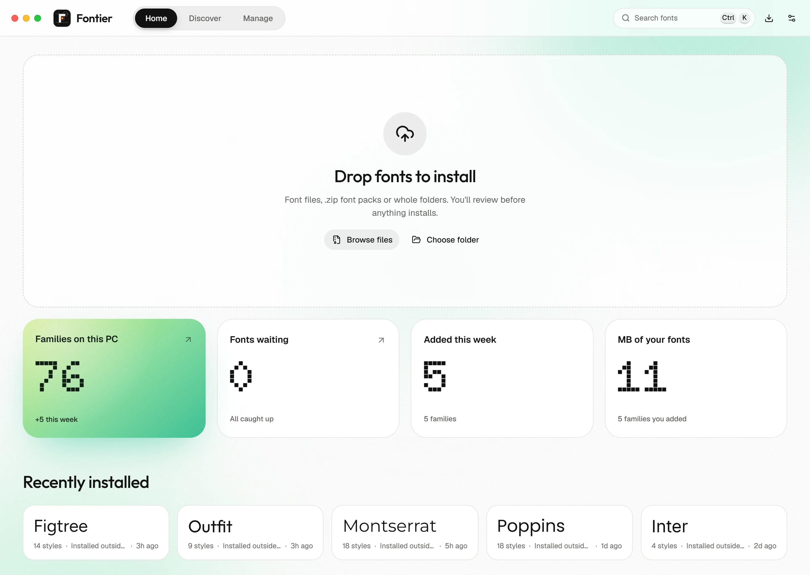
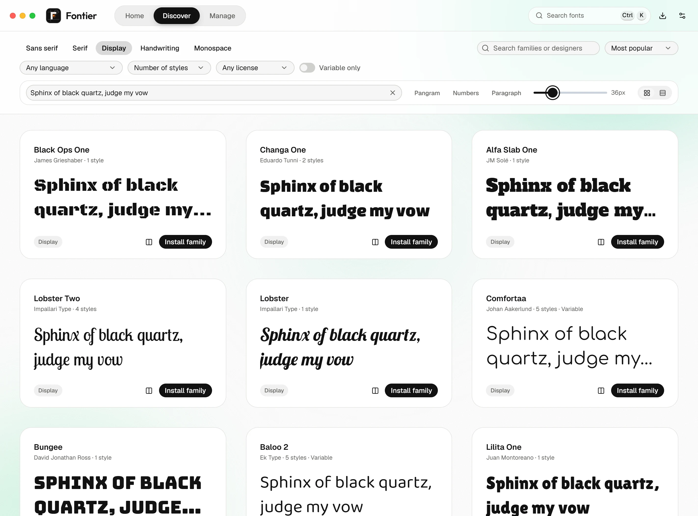
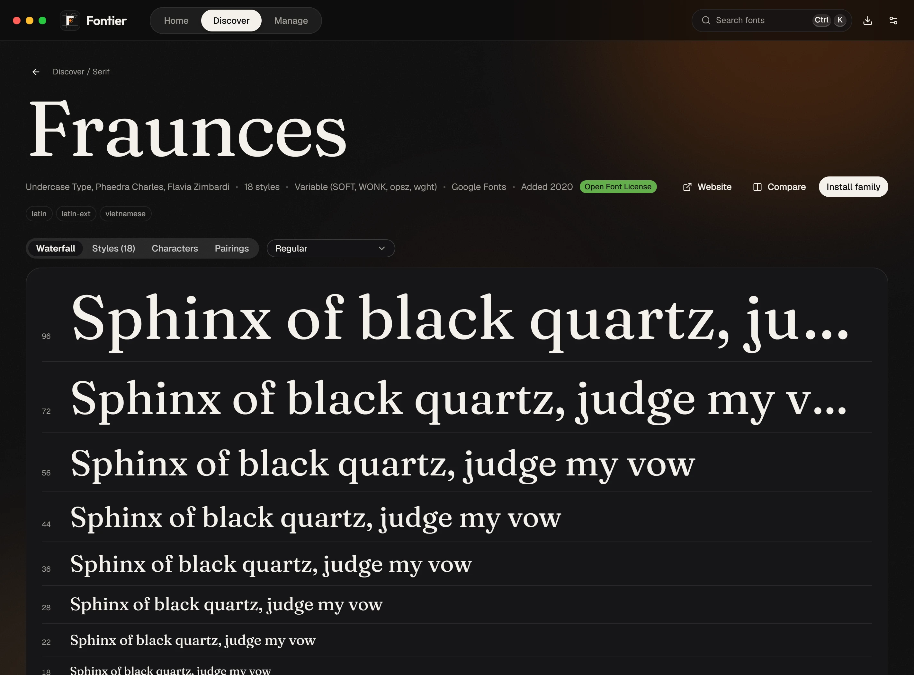
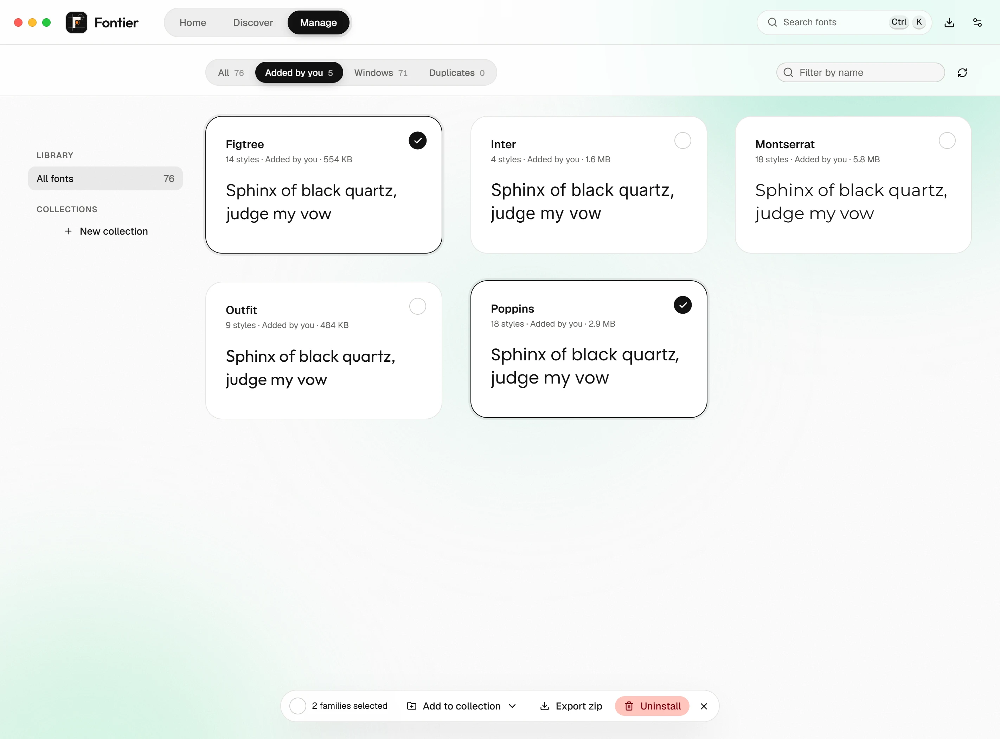

# Fontier

**Install, discover and manage fonts in bulk on Windows.** Fontier installs a whole pile of fonts in one go (files, zips or folders), lets you browse about 2,000 free open-licensed families with live previews, keeps everything you have installed in one place, and can install new font downloads automatically while it sits in the tray.

Built with Tauri 2 (Rust) + React + Meta's Astryx design system. Windows 10/11.



| Discover | Family page (dark theme) |
|---|---|
|  |  |



## Capabilities

### Smart install
- Watches your Downloads (and any folders you add) and **installs new fonts about a second after they land**: loose font files, zips that contain fonts, or folders of fonts. Everything else in the folder is ignored.
- **Zips are never touched.** Fonts are copied out to a temporary folder, installed, and the temporary copies are deleted.
- Works while Fontier is in the tray; each install shows a toast with **Undo** and reminds you to restart apps like Photoshop or Figma that need it.

### Home
- **Drop to install.** Drag font files, `.zip` packs or whole folders anywhere onto the window (or use *Browse files* / *Choose folder*). A review sheet lists every family found, previewed in its own typeface, marks what is already installed, shows the license (and warns about *personal use only*), and lets you install for just you or for everyone on the PC.
- **Stat tiles.** Families on this PC (opens Manage), Fonts waiting (opens the list of font packs in your Downloads), Added this week, and the space your own fonts use.
- **Recently installed.** The last 20 families installed by any route: Fontier, Smart install, Windows' right-click *Install*, or other apps. Fonts that ship with Windows are left out (detected by TrustedInstaller file ownership). Copy the name, open it, or uninstall with Undo.

### Discover
- About **2,000 free families** from Google Fonts and Fontsource (Font Squirrel when its site allows apps). All are licensed for commercial use (OFL, Apache, UFL, CC0).
- **Live previews** loaded as you scroll, with your own preview text, presets and a size slider; grid or list view. Fonts you already have are hidden.
- **Filters:** category (sans serif, serif, display, handwriting, monospace), language/script (Latin, Devanagari, Bengali, Gujarati, Gurmukhi, Kannada, Malayalam, Tamil, Telugu, Odia, Arabic, CJK and more), number of styles, license, variable fonts; search by family or designer; sort by popularity, newest, name or style count.
- **Family pages:** waterfall at every size, every style (install the whole family or only the styles you tick), a live weight slider for variable fonts, character sets per script, and pairing suggestions.
- **Compare** up to four families side by side with the same text.
- **One-click install** downloads the full-quality font files (static by default; variable optional) with live progress.

### Manage
- Every installed family as a tile previewed in its own font, filtered by All, Added by you, Windows and Duplicates, with a name filter.
- **Select** tiles (round selection marks) for bulk actions in a floating bar: add to a collection, export as a zip, uninstall (with Undo). Windows' own fonts are protected.
- **Details** for any family: every style with version, designer and file location, license text, Show in Explorer, Open in Discover.
- **Collections** (e.g. *Brand fonts*) that can be exported as a zip to share with the team.


### Duplicate protection
Before anything is installed (Smart install, drop, Discover), each font is checked against everything on the PC by **family + style, full name and PostScript name**. If any matches, it is skipped, so the same font is never installed twice under a different file name or from a renamed zip.

### Tray and startup
- Lives in the **system tray**; closing the window hides it (Quit from the tray menu).
- **Start with Windows** quietly in the tray.
- **Single instance:** launching Fontier again brings the running window back.

### Updates
- Fontier checks this repository's latest GitHub release when it starts (and twice a day while it runs in the tray). When a newer version is out, it says so and updates in place with one click, then reopens.
- Updates are signed: the app only installs files signed with the Fontier release key, so a tampered download is refused.
- *Settings › Updates* shows the current version and has *Check for updates*.


## Install
Download `Fontier_<version>_x64-setup.exe` from the [latest release](https://github.com/nitish-094s/fontier/releases/latest) and run it.

Uninstall from *Settings › Apps › Fontier*. The uninstaller removes the app.

Fonts are installed exactly like Windows' own *Install*: per user in `%LOCALAPPDATA%\Microsoft\Windows\Fonts` (registered under `HKCU`). *Install for everyone* uses an elevated step with a UAC prompt.

## Privacy
No accounts and no telemetry. Fontier only connects to the font libraries (Google Fonts, Fontsource, Font Squirrel) to list, preview and download fonts, and to GitHub to check for updates.

## Develop

```powershell
npm install
npm run tauri dev
```

## Build the installer

```powershell
npm run tauri build
```

The installer lands in `src-tauri\target\release\bundle\nsis\`.

## Release a new version
1. Bump `version` in `src-tauri/tauri.conf.json`, `src-tauri/Cargo.toml` and `package.json`.
2. Build with the release key (kept outside the repo, never committed):
   ```powershell
   $env:TAURI_SIGNING_PRIVATE_KEY = "$env:USERPROFILE\.tauri\fontier-updater.key"
   $env:TAURI_SIGNING_PRIVATE_KEY_PASSWORD = ""
   npm run tauri build
   ```
   Next to the installer this writes `Fontier_<version>_x64-setup.exe.sig`, the update signature.
3. Write the update manifest and publish the release:
   ```powershell
   node scripts/latest-json.mjs "What changed in this version"
   gh release create v<version> --title "Fontier <version>" --notes "What changed" `
     src-tauri\target\release\bundle\nsis\Fontier_<version>_x64-setup.exe src-tauri\target\release\bundle\nsis\latest.json
   ```
   Installed copies find it through `releases/latest/download/latest.json`. Lose the key and existing installs can no longer be updated, so keep a copy somewhere safe.

Artwork is generated from SVG sources in `design/`:

```powershell
node design/build-icons.cjs            # app icon set (after: npx tauri icon design/fontier-icon-1024.png)
node design/build-installer-art.cjs    # installer sidebar + header bitmaps
```

## Project layout
- `src-tauri/src/fonts.rs`: reading fonts (ttf-parser), font identities, Windows registry/GDI install and uninstall, Windows-font detection
- `src-tauri/src/archive.rs`: scanning drops, finding fonts in zips/folders, safe zip extraction
- `src-tauri/src/smart.rs`: Smart install (folder watcher, temp extraction, install, clean-up)
- `src-tauri/src/net.rs`: online font library catalog and family downloads
- `src-tauri/src/lib.rs`: app commands, tray, start-with-Windows, single instance, updater
- `scripts/latest-json.mjs`: writes the update manifest (`latest.json`) for a release
- `src-tauri/installer/`: the installer: `installer.nsi` (Tauri's NSIS template with Fontier changes marked "Fontier:": no folder or Start menu pages.
- `src/pages/`: Home, Discover, FamilyView, Compare, Manage, Settings
- `design/`: icon, tray and installer artwork sources

## License
[MIT](LICENSE)
